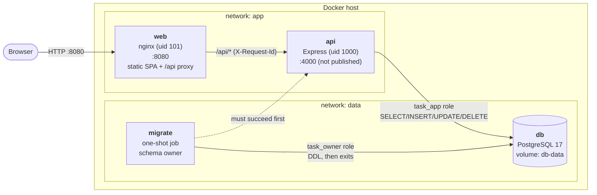
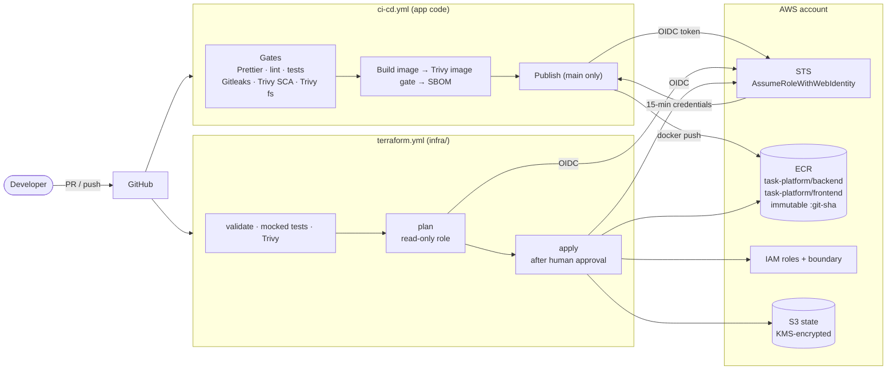

# AWS Three-Tier Web Platform

A deliberately simple **task manager**, built to production standards as a reference for
running a three-tier web application with secure, automated delivery to AWS.

- **Presentation:** React 19 + TypeScript + Tailwind CSS, served by unprivileged nginx
- **Application:** Node.js 22 + Express 5 + TypeScript REST API
- **Data:** PostgreSQL 17 with versioned SQL migrations
- **Delivery:** Docker multi-stage images; GitHub Actions with Prettier, ESLint, tests,
  Gitleaks and Trivy gates; images pushed to Amazon ECR through GitHub OIDC with immutable
  commit-SHA tags
- **Infrastructure:** Terraform for ECR and IAM, delivered by its own plan → approve → apply
  pipeline

Users can create, view, edit and delete tasks, mark them completed or pending, and filter by
status, in a responsive, accessible UI with light and dark themes.

## Contents

- [Architecture](#architecture)
- [Repository layout](#repository-layout)
- [Prerequisites](#prerequisites)
- [Quick start (Docker Compose)](#quick-start-docker-compose)
- [Local development](#local-development)
- [Docker Compose deployment](#docker-compose-deployment)
- [API](#api)
- [Environment variables](#environment-variables)
- [CI/CD pipelines](#cicd-pipelines)
- [AWS setup: OIDC and ECR](#aws-setup-oidc-and-ecr)
- [Security controls and scanning strategy](#security-controls-and-scanning-strategy)
- [Testing](#testing)
- [Troubleshooting](#troubleshooting)
- [Further documentation](#further-documentation)

## Architecture

Three independently built and deployable tiers. Each has its own Dockerfile, lockfile and
image, and each talks only to the tier next to it.

| Tier         | Technology                           | Responsibility                                                                                    |
| ------------ | ------------------------------------ | ------------------------------------------------------------------------------------------------- |
| Presentation | React, TypeScript, Tailwind, nginx   | Serves the single-page app, sets security headers, reverse-proxies `/api` to the application tier |
| Application  | Express, TypeScript, Zod, pino, `pg` | REST API: validation, business rules, parameterized SQL, structured logs, health probes           |
| Data         | PostgreSQL                           | Persistent storage; constraints mirror API validation; least-privilege runtime role               |

### Runtime



- The browser only ever talks to nginx. It calls the **relative** path `/api`, so the bundle
  contains no URLs, the same image runs in every environment, and no CORS is needed.
- `api` sits on both networks. `web` cannot reach `db`, and the API isn't published on the
  host.
- Startup order is enforced with health checks: `db` healthy → `migrate` completes
  successfully → `api` ready (database reachable) → `web`.

### Delivery



No AWS access keys exist anywhere. Every AWS call from CI uses short-lived credentials
obtained by exchanging a GitHub OIDC token, and each role trusts one exact token subject.

## Repository layout

```text
.
├── frontend/                 # Presentation tier (Vite + React + Tailwind)  → frontend/README.md
├── backend/                  # Application tier (Express API)               → backend/README.md
├── database/
│   ├── init/                 # first-boot script: creates the least-privilege app role
│   └── migrations/           # forward-only SQL migrations (applied by the backend's runner)
├── docker/
│   ├── backend.Dockerfile    # multi-stage → node:22-alpine, non-root, no npm
│   ├── frontend.Dockerfile   # multi-stage → nginx-unprivileged
│   └── nginx/                # site template (envsubst) + security-header snippet
├── infra/
│   ├── bootstrap/            # admin-applied once: state bucket, OIDC, pipeline roles, boundary
│   └── terraform/            # ECR repositories + image push role (via terraform.yml)
├── .github/
│   ├── workflows/ci-cd.yml   # app pipeline
│   ├── workflows/terraform.yml # infrastructure pipeline
│   └── dependabot.yml        # npm, Docker, Terraform and Actions updates
├── docs/                     # pipeline guides, implementation plan and decisions
├── docker-compose.yml        # db + migrate + api + web
├── .env.example              # Compose variables (copy to .env)
└── .gitleaks.toml, .prettierrc.json, .editorconfig, .nvmrc, .dockerignore
```

## Prerequisites

| Tool                    | Version                                    | Needed for                               |
| ----------------------- | ------------------------------------------ | ---------------------------------------- |
| Docker + Docker Compose | Docker 20.10+, Compose v2                  | running the stack, integration tests     |
| Node.js + npm           | Node 22 (see `.nvmrc`), npm 10             | local development, tests                 |
| Terraform               | `~> 1.10` (CI uses 1.15.7)                 | infrastructure changes and tests         |
| AWS CLI                 | v2                                         | one-time AWS bootstrap, pulling from ECR |
| Trivy, Gitleaks         | optional (CI runs pinned container images) | running the security scans locally       |

Ports used on the host by default: **8080** (web) and **5432** (PostgreSQL, loopback only).
Both are configurable in `.env`.

## Quick start (Docker Compose)

```bash
cp .env.example .env
```

Edit `.env` and replace both `change-me-…` passwords, then:

```bash
docker compose up -d --build
```

Open <http://localhost:8080>. The first build takes about a minute. Check status:

```bash
docker compose ps
```

`migrate` should show `Exited (0)` and the other three services `healthy`.

Stop the stack, keeping data:

```bash
docker compose down
```

Stop and **delete all data** (the volume):

```bash
docker compose down -v
```

## Local development

Run the database in Docker and the API and UI on the host, for hot reload.

**1. Database** (with a filled-in root `.env`):

```bash
docker compose up -d db
```

**2. API** on <http://localhost:4000>:

```bash
cd backend
cp .env.example .env    # set DB_PASSWORD to APP_DB_PASSWORD from the root .env
npm ci
DB_USER=task_owner DB_PASSWORD='<POSTGRES_PASSWORD>' npm run migrate:dev   # schema owner
npm run dev
```

**3. UI** on <http://localhost:5173>. It proxies `/api` to port 4000:

```bash
cd frontend
npm ci
npm run dev
```

**Checks before pushing.** These are the same ones CI runs:

```bash
npm ci && npm run format:check                                      # repo root
(cd backend  && npm run typecheck && npm run lint && npm test)
(cd frontend && npm run typecheck && npm run lint && npm test && npm run build)
```

Backend integration tests need a disposable database whose name ends in `_test` (the tests
refuse to run otherwise):

```bash
docker compose exec db psql -U task_owner -d taskdb -c 'CREATE DATABASE taskdb_test'
```

```bash
cd backend && TEST_DATABASE_URL='postgres://task_owner:<POSTGRES_PASSWORD>@localhost:5432/taskdb_test' npm run test:integration
```

## Docker Compose deployment

[`docker-compose.yml`](docker-compose.yml) runs the full stack:

| Service   | Image                          | Role                                                         | Health / readiness                    |
| --------- | ------------------------------ | ------------------------------------------------------------ | ------------------------------------- |
| `db`      | `postgres:17-alpine`           | data; named volume `db-data`; port bound to `127.0.0.1`      | `pg_isready` over TCP                 |
| `migrate` | `task-api` (`dist/migrate.js`) | applies pending migrations as the schema owner, then exits   | must exit 0 before `api` starts       |
| `api`     | `task-api`                     | REST API as `task_app` (DML only); not published on the host | `GET /health/ready` (checks database) |
| `web`     | `task-web`                     | nginx: SPA, `/api` proxy, security headers                   | `GET /healthz`                        |

**Hardening on `migrate`, `api` and `web`:**

- read-only root filesystem, with explicit in-memory scratch space
- all Linux capabilities dropped and `no-new-privileges`
- non-root users

**Running published images from ECR** instead of building locally:

```bash
aws ecr get-login-password --region us-east-1 | docker login --username AWS --password-stdin <account>.dkr.ecr.us-east-1.amazonaws.com
```

Then set the images in `.env`:

```bash
API_IMAGE=<account>.dkr.ecr.us-east-1.amazonaws.com/task-platform/backend:<git-sha>
WEB_IMAGE=<account>.dkr.ecr.us-east-1.amazonaws.com/task-platform/frontend:<git-sha>
```

and start without building:

```bash
docker compose pull && docker compose up -d --no-build
```

**Operations:**

| Task                    | Command                                                               |
| ----------------------- | --------------------------------------------------------------------- |
| Follow API logs (JSON)  | `docker compose logs -f api`                                          |
| Re-run migrations       | `docker compose run --rm migrate`                                     |
| Back up the database    | `docker compose exec -T db pg_dump -U task_owner taskdb > backup.sql` |
| Restore a backup        | `docker compose exec -T db psql -U task_owner -d taskdb < backup.sql` |
| Graceful restart of API | `docker compose restart api` (finishes in-flight requests on SIGTERM) |

To change the schema, add `database/migrations/NNN_description.sql`. Never edit a migration
that has been applied: the runner stores a checksum of each file and refuses to continue if
one changes.

## API

Base path `/api`, JSON only. Full details in [backend/README.md](backend/README.md).

| Method   | Path                                            | Success                               |
| -------- | ----------------------------------------------- | ------------------------------------- |
| `GET`    | `/api/tasks?status=pending\|completed`          | `200 { data: Task[] }` (newest first) |
| `POST`   | `/api/tasks` `{ title, description?, status? }` | `201 { data: Task }` + `Location`     |
| `GET`    | `/api/tasks/:id`                                | `200 { data: Task }`                  |
| `PATCH`  | `/api/tasks/:id` (any subset of fields)         | `200 { data: Task }`                  |
| `DELETE` | `/api/tasks/:id`                                | `204`                                 |

Errors always have the shape
`{ "error": { "code": "VALIDATION_ERROR", "message": "…", "details": [{ "path": "title", "message": "…" }] } }`:

| Status | When                                                                   |
| ------ | ---------------------------------------------------------------------- |
| 400    | validation failure, malformed JSON or an unknown field                 |
| 404    | no such task, or unknown route                                         |
| 413    | request body too large                                                 |
| 503    | database unavailable                                                   |
| 500    | anything unexpected; returns a generic message, never internal details |

Every response carries an `X-Request-Id`, which also appears in the logs.

The API's health endpoints (`/health/live`, `/health/ready`) are for orchestrators, and
nginx deliberately doesn't expose them.

## Environment variables

None of the values below are secrets except the two database passwords, which live only in
the git-ignored `.env`. They are never baked into images or set as defaults.

### Docker Compose (`.env` at the repository root)

| Variable             | Default          | Secret | Description                                                            |
| -------------------- | ---------------- | ------ | ---------------------------------------------------------------------- |
| `POSTGRES_DB`        | `taskdb`         |        | Database name                                                          |
| `POSTGRES_USER`      | `task_owner`     |        | Schema owner; used only by `migrate`                                   |
| `POSTGRES_PASSWORD`  | **required**     | ✔      | Owner password                                                         |
| `APP_DB_USER`        | `task_app`       |        | Least-privilege runtime role used by `api`                             |
| `APP_DB_PASSWORD`    | **required**     | ✔      | Runtime role password. Read on first initialisation of the volume only |
| `POSTGRES_HOST_PORT` | `5432`           |        | Host port for PostgreSQL (bound to `127.0.0.1`)                        |
| `WEB_HOST_PORT`      | `8080`           |        | Host port for the web UI                                               |
| `LOG_LEVEL`          | `info`           |        | API log level (`fatal` … `trace`, `silent`)                            |
| `API_IMAGE`          | `task-api:local` |        | API image to run (e.g. an ECR URI)                                     |
| `WEB_IMAGE`          | `task-web:local` |        | Web image to run                                                       |

Compose refuses to start if a required variable is missing (`${VAR:?}`) rather than
falling back to a default.

### API container / `backend/.env`

| Variable         | Default                  | Description                                                                              |
| ---------------- | ------------------------ | ---------------------------------------------------------------------------------------- |
| `NODE_ENV`       | `production`             | `development` \| `test` \| `production`                                                  |
| `PORT`           | `4000`                   | Listen port                                                                              |
| `LOG_LEVEL`      | `info`                   | pino level                                                                               |
| `DB_HOST`        | **required**             | PostgreSQL host                                                                          |
| `DB_PORT`        | `5432`                   |                                                                                          |
| `DB_NAME`        | **required**             |                                                                                          |
| `DB_USER`        | **required**             | App role at runtime; owner role for `migrate`                                            |
| `DB_PASSWORD`    | **required**             | Never logged or echoed in configuration errors                                           |
| `DB_SSL`         | `false`                  | `true` enables TLS **with** certificate verification (use `NODE_EXTRA_CA_CERTS` for RDS) |
| `DB_POOL_MAX`    | `10`                     | Connection pool size                                                                     |
| `MIGRATIONS_DIR` | `../database/migrations` | `/app/migrations` in the image                                                           |

The configuration is validated once at startup. If anything is invalid, the process exits
and names every bad variable, without printing its value.

### Web container and frontend dev server

| Variable           | Default                 | Where                                                                    |
| ------------------ | ----------------------- | ------------------------------------------------------------------------ |
| `API_UPSTREAM`     | `http://api:4000`       | `web` container: where nginx proxies `/api`, substituted at startup      |
| `API_PROXY_TARGET` | `http://localhost:4000` | `frontend/.env`: Vite dev-server proxy only; never in the browser bundle |

### GitHub repository variables (Settings → Secrets and variables → Actions → Variables)

Both pipelines need **no GitHub secrets**. These are identifiers, produced as Terraform
outputs.

| Variable                      | Pipeline        | Source                                                       |
| ----------------------------- | --------------- | ------------------------------------------------------------ |
| `AWS_REGION`                  | both            | `infra/bootstrap` output `aws_region`                        |
| `AWS_ROLE_ARN`                | `ci-cd.yml`     | `infra/terraform` output `github_actions_role_arn`           |
| `ECR_REPOSITORY_BACKEND`      | `ci-cd.yml`     | optional; default `task-platform/backend`                    |
| `ECR_REPOSITORY_FRONTEND`     | `ci-cd.yml`     | optional; default `task-platform/frontend`                   |
| `TF_STATE_BUCKET`             | `terraform.yml` | `infra/bootstrap` output `tf_state_bucket`                   |
| `TF_PLAN_ROLE_ARN`            | `terraform.yml` | `infra/bootstrap` output `tf_plan_role_arn`                  |
| `TF_APPLY_ROLE_ARN`           | `terraform.yml` | `infra/bootstrap` output `tf_apply_role_arn`                 |
| `TF_PERMISSIONS_BOUNDARY_ARN` | `terraform.yml` | `infra/bootstrap` output `app_role_permissions_boundary_arn` |
| `TF_STATE_KEY`                | `terraform.yml` | optional; default `task-platform/ecr/terraform.tfstate`      |

Until the AWS variables are set, both pipelines still run every quality and security gate
and skip only the AWS steps, with a warning.

## CI/CD pipelines

### Application: [`ci-cd.yml`](.github/workflows/ci-cd.yml)

Runs on pull requests and pushes to `main`, except changes that touch only `infra/`.

| #   | Step                   | Implementation                                                                             |
| --- | ---------------------- | ------------------------------------------------------------------------------------------ |
| 1   | Checkout               | `actions/checkout`, `persist-credentials: false`                                           |
| 2   | Node.js                | `actions/setup-node` reading `.nvmrc`, npm cache                                           |
| 3   | Install from lockfiles | `npm ci --ignore-scripts` (no dependency install scripts)                                  |
| 4   | Format                 | `prettier --check .`                                                                       |
| 5   | Lint + tests           | ESLint (type-aware), `tsc`, Vitest; backend integration tests against a PostgreSQL service |
| 6   | Secret scan            | Gitleaks over the **entire git history**                                                   |
| 7   | SCA                    | Trivy on every `package-lock.json`, dev dependencies included                              |
| 8   | Filesystem scan        | Trivy vulnerabilities + misconfigurations (Dockerfiles, Terraform) + secrets               |
| 9   | Build images           | Buildx, one per tier, GitHub Actions cache, exported to a tarball                          |
| 10  | Scan images            | Trivy on that exact tarball; JSON report and CycloneDX SBOM kept as artifacts              |
| 11  | AWS auth               | `aws-actions/configure-aws-credentials` via OIDC, 15-minute session                        |
| 12  | Push to ECR            | the scanned tarball, tagged `:<full git SHA>`; re-runs are idempotent                      |

Steps 4–8 run as parallel jobs. Building waits for **all** of them, and publishing waits
for the image scan. Publishing runs only on pushes to `main`, so no image reaches ECR
unless every check passed. Details: [docs/ci-cd.md](docs/ci-cd.md).

### Infrastructure: [`terraform.yml`](.github/workflows/terraform.yml)

Runs when `infra/` changes. Steps:

1. **validate**, for both stacks: `fmt`, `validate`, and `terraform test` against a mocked
   AWS provider.
2. **security**: a Trivy scan of `infra/`.
3. **plan**, using a read-only role. The plan appears in the job summary, and on `main` it is
   also saved as an artifact.
4. **apply**, using the apply role. It waits until a reviewer approves the `infrastructure`
   GitHub environment, then applies **exactly the saved plan**.

Details: [docs/terraform-pipeline.md](docs/terraform-pipeline.md).

## AWS setup: OIDC and ECR

The result is two private ECR repositories with immutable tags and scan-on-push, and IAM
roles that GitHub Actions assumes through OIDC. There are no access keys anywhere.

### How the OIDC trust works

1. A workflow job with `id-token: write` asks GitHub for a signed token whose `sub` claim
   identifies the run, e.g. `repo:<owner>/<repo>:ref:refs/heads/main`.
2. `aws-actions/configure-aws-credentials` sends it to STS `AssumeRoleWithWebIdentity`.
3. AWS verifies the signature against the account's GitHub OIDC provider and checks the
   role's trust policy, which requires `aud = sts.amazonaws.com` and an **exact** `sub`.
4. STS returns credentials that expire in 15 minutes (image push) or 30 minutes (apply).

| Role                            | Trusted `sub`                                       | Can do                                                                  |
| ------------------------------- | --------------------------------------------------- | ----------------------------------------------------------------------- |
| `task-platform-github-ecr-push` | `repo:<repo>:ref:refs/heads/main`                   | ECR login + push to `task-platform/*`; capped by a permissions boundary |
| `task-platform-terraform-plan`  | `repo:<repo>:pull_request`, `…:ref:refs/heads/main` | read the ECR stack's resources and state                                |
| `task-platform-terraform-apply` | `repo:<repo>:environment:infrastructure`            | manage the ECR stack; may create roles **only** with the boundary       |

### One-time setup

Use an **IAM administrator, not the account root user.**

1. **Bootstrap** (state bucket, KMS key, OIDC provider, pipeline roles, boundary). Full
   steps are in [infra/bootstrap/README.md](infra/bootstrap/README.md).

   ```bash
   cd infra/bootstrap && cp terraform.tfvars.example terraform.tfvars   # set github_repository
   terraform init && terraform plan -out=bootstrap.tfplan             # review: 15 to add
   terraform apply bootstrap.tfplan && terraform output
   ```

2. **GitHub variables:** set `AWS_REGION`, `TF_STATE_BUCKET`, `TF_PLAN_ROLE_ARN`,
   `TF_APPLY_ROLE_ARN` and `TF_PERMISSIONS_BOUNDARY_ARN` from those outputs.

3. **GitHub environment:** Settings → Environments → `infrastructure`. Add **required
   reviewers** and limit deployment branches to **`main`**. This approval is what gates
   every infrastructure change.

4. **Create ECR and the push role through the pipeline.** Push to `main` (or run the
   _Terraform_ workflow), review the plan, and approve the `apply` job. Its summary shows
   `github_actions_role_arn`.

5. **Enable publishing:** set `AWS_ROLE_ARN` to that value. The next push to `main`
   publishes both images.

6. **Verify:**

   ```bash
   aws ecr describe-images --repository-name task-platform/backend \
     --query 'sort_by(imageDetails,&imagePushedAt)[-1].{tags:imageTags,scan:imageScanStatus.status}'
   ```

**ECR configuration** ([infra/terraform/ecr.tf](infra/terraform/ecr.tf)):

- tag mutability `IMMUTABLE`
- `scan_on_push`
- AES-256 encryption
- a lifecycle policy that expires untagged layers after 1 day and keeps the newest 30 images
- repositories aren't force-deleted, so images can't be lost by accident

## Security controls and scanning strategy

The principle is defence in depth: every risky input is checked at more than one layer, and
every automated identity can do as little as possible.

### Controls by layer

| Layer               | Controls                                                                                                                                                                                                                                     |
| ------------------- | -------------------------------------------------------------------------------------------------------------------------------------------------------------------------------------------------------------------------------------------- |
| **Browser / edge**  | Strict CSP (`'self'` only, no inline scripts or styles), `X-Frame-Options: DENY`, `nosniff`, Referrer/Permissions/COOP policies, version hidden, 64 KB body limit                                                                            |
| **API**             | Zod validation of body, params and query (unknown fields rejected); 16 KB JSON limit; Helmet; one error handler that never leaks internals; request ids; sensitive headers redacted in logs; statement timeouts                              |
| **Database**        | Parameterized SQL only (column names come from a fixed list); `CHECK` constraints mirror the API rules; the runtime role can't run DDL (tested: `DROP`, `CREATE` and `TRUNCATE` are refused)                                                 |
| **Configuration**   | Validated at startup, failing fast; secrets only through the environment; `.env` git-ignored; `.dockerignore` is an allowlist                                                                                                                |
| **Containers**      | Multi-stage builds; non-root users; no compiler, npm or package managers in the API image; OS patches applied at build; read-only root filesystem, all capabilities dropped and `no-new-privileges` in Compose; base images pinned by digest |
| **Network**         | `web` ↔ `api` ↔ `db` on separate networks; API not published; database bound to loopback                                                                                                                                                     |
| **Supply chain**    | Lockfiles with `npm ci --ignore-scripts`; actions pinned to commit SHAs; scanner and base images pinned by digest; Dependabot for npm, Docker, Terraform and Actions                                                                         |
| **CI permissions**  | Default `contents: read`; only publish, plan and apply jobs may request OIDC tokens; fork PRs never get AWS access                                                                                                                           |
| **AWS identity**    | No access keys; exact-match OIDC trust per role; push-only and read-only roles; apply role gated by environment approval, unable to escalate (permissions boundary, explicit denies), unable to touch its own roles or the bootstrap state   |
| **Terraform state** | S3 with versioning, a customer-managed KMS key (rotating), public access blocked, TLS-only policy, native locking                                                                                                                            |

### Scanning

| Scanner          | Where it runs                | Scope                                                         | Fails the pipeline on                           |
| ---------------- | ---------------------------- | ------------------------------------------------------------- | ----------------------------------------------- |
| Gitleaks         | `ci-cd.yml` → `secrets`      | full git history                                              | any finding                                     |
| Trivy SCA        | `ci-cd.yml` → `sca`          | all npm lockfiles, including dev dependencies                 | HIGH/CRITICAL with a fix available              |
| Trivy filesystem | `ci-cd.yml` → `fs-scan`      | dependencies, Dockerfiles, Terraform, secrets                 | HIGH/CRITICAL vuln (fixable), misconfig, secret |
| Trivy image      | `ci-cd.yml` → `build-scan`   | OS packages, app dependencies and secrets in each built image | HIGH/CRITICAL with a fix available, any secret  |
| Trivy config     | `terraform.yml` → `security` | `infra/` misconfigurations and secrets                        | HIGH/CRITICAL                                   |
| `terraform test` | `terraform.yml` → `validate` | IAM trust, least privilege, boundary, ECR hardening           | any failing assertion                           |
| ECR basic scan   | on every push to ECR         | published images                                              | (reporting; second opinion)                     |

**Why only fixable HIGH/CRITICAL vulnerabilities block:** a finding with no released fix
can't be acted on, and blocking on it would stop every deploy until upstream ships a fix.
Such findings still appear in the reports and SBOM artifacts and are re-checked every run,
so they start blocking as soon as a fix exists. MEDIUM and LOW findings are visible in the
artifacts.

### Accepted risks (documented exceptions)

| Item                                              | Severity | Decision                                                                                                                  |
| ------------------------------------------------- | -------- | ------------------------------------------------------------------------------------------------------------------------- |
| `minimatch` advisory in ESLint tooling            | MEDIUM   | Dev-only, not in any image; the only fix npm offers downgrades `typescript-eslint`. Dependabot will pick up a proper fix  |
| ECR without a customer-managed KMS key (AWS-0033) | LOW      | Images contain no secrets; AWS-managed AES-256 is sufficient. Marked inline in `ecr.tf`                                   |
| State bucket without access logging (AWS-0089)    | LOW      | Would need a second bucket with the same finding; access is only through IAM roles that CloudTrail records. Marked inline |
| Unlocked plans                                    | n/a      | The plan role can't write the lock; a stale plan can't be applied                                                         |
| PR plans with the plan role                       | n/a      | A PR that edits the workflow could read the ECR stack's state; the role is read-only and narrowly scoped                  |

## Testing

| Suite                | Command                                | Count | What it covers                                                                     |
| -------------------- | -------------------------------------- | ----- | ---------------------------------------------------------------------------------- |
| Backend unit         | `cd backend && npm test`               | 44    | config, schemas, routes, error mapping, health, headers, request ids               |
| Backend integration  | `npm run test:integration`             | 10    | real PostgreSQL: CRUD, trigger, ordering, injection-style input, migration runner  |
| Frontend             | `cd frontend && npm test`              | 22    | API client, validation, full UI flows against a fake API                           |
| Terraform: ECR stack | `cd infra/terraform && terraform test` | 8     | immutable/scanned repos, exact trust, push-only scope, boundary attached           |
| Terraform: bootstrap | `cd infra/bootstrap && terraform test` | 8     | encrypted private state, plan role read-only, apply trust, no privilege escalation |

The Terraform tests use a mocked provider, so they need no AWS credentials and cost nothing.

## Troubleshooting

| Symptom                                                                   | Cause / fix                                                                                                               |
| ------------------------------------------------------------------------- | ------------------------------------------------------------------------------------------------------------------------- |
| `invalid interpolation format` from `docker compose`                      | A required variable is missing from `.env`. Older Compose versions print this instead of the variable's name              |
| `Bind for 0.0.0.0:8080 failed: port is already allocated`                 | Set `WEB_HOST_PORT` (or `POSTGRES_HOST_PORT`) in `.env`                                                                   |
| `api` restarts or `web` never starts                                      | `docker compose logs migrate api`. Usually wrong database credentials                                                     |
| `password authentication failed for user "task_app"` after editing `.env` | The app role is created only on first initialisation. Reset with `docker compose down -v` (deletes data)                  |
| Migration fails with "was modified after being applied"                   | An applied migration was edited. Revert the edit and add a new migration                                                  |
| Integration tests refuse to run                                           | `TEST_DATABASE_URL` must point at a database whose name ends in `_test`                                                   |
| `publish` / `plan` skipped in Actions                                     | The AWS repository variables aren't set yet (see [AWS setup](#aws-setup-oidc-and-ecr))                                    |
| Terraform `apply` fails with "Saved plan is stale"                        | State changed after the plan. Re-run the workflow and review the new plan                                                 |
| `Docker exporter feature is currently not supported` locally              | Your default Buildx builder can't export tarballs; CI uses a `docker-container` builder. Use `docker buildx create --use` |

## Further documentation

- [backend/README.md](backend/README.md): API design, layering, scripts, configuration
- [frontend/README.md](frontend/README.md): UI structure, API access, scripts
- [docs/ci-cd.md](docs/ci-cd.md): the application pipeline in detail
- [docs/terraform-pipeline.md](docs/terraform-pipeline.md): the infrastructure pipeline and approval flow
- [infra/bootstrap/README.md](infra/bootstrap/README.md): one-time AWS bootstrap and privilege-escalation safeguards
- [infra/terraform/README.md](infra/terraform/README.md): ECR stack and image push role
- [docs/implementation-plan.md](docs/implementation-plan.md): how the project was built, phase by phase, and the key decisions
