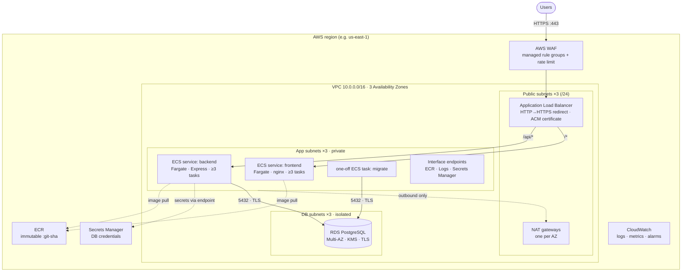

# AWS deployment architecture

Target production environment for the task platform: highly available across three
Availability Zones, private by default, and delivered entirely through Terraform and GitHub
Actions. This document is the design and the build plan. Sections are marked **built** or
**planned** as phases land.

## Target architecture



### Traffic and trust boundaries

| From → To               | Allowed                             | Enforced by                                          |
| ----------------------- | ----------------------------------- | ---------------------------------------------------- |
| Internet → ALB          | 443 (80 only to redirect to 443)    | ALB security group, WAF                              |
| ALB → frontend tasks    | 8080                                | frontend SG allows only the ALB SG                   |
| ALB → backend tasks     | 4000, only for `/api/*`             | listener rule + backend SG allows only the ALB SG    |
| backend / migrate → RDS | 5432 over TLS                       | RDS SG allows only the backend SG; `rds.force_ssl=1` |
| Tasks → AWS APIs        | 443 to VPC endpoints                | endpoint SG allows only app subnets                  |
| Tasks → internet        | outbound via the NAT in the same AZ | route tables; no inbound path                        |
| DB subnets → internet   | **none**                            | route table has only the local route                 |

## Decisions and trade-offs

| Topic                      | Decision                                                                                                                                           | Trade-off                                                                                                                                                                         |
| -------------------------- | -------------------------------------------------------------------------------------------------------------------------------------------------- | --------------------------------------------------------------------------------------------------------------------------------------------------------------------------------- |
| **Subnet sizing**          | `/24` public, `/20` app, `/24` DB from a `/16`                                                                                                     | Each Fargate task uses one IP, so app subnets get 4,096 addresses each for scaling and rolling deploys. Public and DB tiers need very few. Plenty of room is left for more tiers. |
| **NAT gateways**           | One per AZ (`nat_gateway_mode = "per_az"`), switchable to `"single"`                                                                               | Per-AZ: losing an AZ doesn't cut outbound access for the others, and there's no cross-AZ data charge. Costs about 3× ($100/month vs $33). `single` suits non-production.          |
| **VPC endpoints**          | S3 gateway endpoint (free); interface endpoints for ECR API, ECR Docker, CloudWatch Logs and Secrets Manager                                       | Image pulls, logs and secret reads stay on the AWS network and keep working if NAT is impaired. Costs about $22/month per interface endpoint across 3 AZs (≈ $88). Configurable.  |
| **Isolated DB subnets**    | No route to the internet or a NAT                                                                                                                  | The database can't reach out even if compromised. RDS doesn't need internet access.                                                                                               |
| **Flow logs**              | VPC flow logs to CloudWatch Logs (REJECT traffic by default)                                                                                       | Network forensics and evidence of blocked traffic at low ingest cost. Use `ALL` for full visibility at higher cost.                                                               |
| **Default security group** | Managed with no rules                                                                                                                              | Nothing can accidentally use a permissive default.                                                                                                                                |
| **Compute**                | ECS on Fargate, frontend and backend as separate services                                                                                          | No hosts to patch, per-task isolation, and each tier scales independently. Fargate costs more per vCPU than EC2, but the operational simplicity is worth it here.                 |
| **Spreading across AZs**   | Services use all three app subnets, with a minimum of 3 tasks each                                                                                 | ECS spreads tasks across AZs by default, so losing one AZ leaves two-thirds of capacity while autoscaling replaces the rest.                                                      |
| **Routing**                | One public ALB: `/api/*` → backend target group, everything else → frontend                                                                        | One certificate, one WAF and one hostname. The browser keeps calling the relative `/api`, so the frontend bundle doesn't change.                                                  |
| **Database**               | RDS PostgreSQL 17, Multi-AZ, gp3, KMS customer-managed key, `force_ssl`, deletion protection, 7-day backups                                        | Multi-AZ doubles instance cost, but gives automatic failover (typically 60–120 s). Aurora would fail over faster and scale reads, at higher minimum cost and more complexity.     |
| **DB credentials**         | Master password managed by RDS in Secrets Manager (rotating); separate app-role secret; ECS injects secrets at task start                          | No password in Terraform variables, task definitions or images. The app keeps the least-privilege role from the local setup.                                                      |
| **Migrations**             | The pipeline runs `migrate` as a one-off Fargate task before updating services                                                                     | Same image and code path as locally. Deploys stop if migrations fail.                                                                                                             |
| **Deployments**            | ECS rolling updates with the deployment circuit breaker (auto-rollback) and ALB health checks; a manual rollback workflow redeploys a previous SHA | Rolling is simple and needs no extra capacity. Blue/green (CodeDeploy) allows instant rollback but adds a lot of moving parts.                                                    |
| **Edge**                   | ALB with ACM certificate (TLS 1.2+ policy), HTTP→HTTPS redirect, AWS WAF with AWS managed rule groups and a per-IP rate limit                      | WAF adds about $10/month plus request fees. CloudFront could be added later for caching and DDoS absorption.                                                                      |
| **Observability**          | Container logs, flow logs and ALB access logs; alarms on 5xx, unhealthy targets, latency, RDS CPU/storage/connections and ECS CPU/memory           | Alarms notify an SNS topic. Dashboards are kept minimal.                                                                                                                          |
| **CPU architecture**       | `X86_64`                                                                                                                                           | Graviton (`ARM64`) is about 20% cheaper on Fargate, but needs multi-arch image builds. Easy to switch later.                                                                      |

## Terraform layout

```text
infra/
├── bootstrap/                 # admin-applied: state, OIDC, pipeline roles, permissions boundary
├── modules/                   # reusable, independently tested modules
│   ├── network/               # VPC, 9 subnets, IGW, NAT, routes, endpoints, flow logs   (built)
│   ├── security-groups/       # tier-to-tier rules                                        (planned)
│   ├── alb/                   # ALB, listeners, target groups, ACM, WAF                   (planned)
│   ├── cloudwatch/            # KMS for logs, log groups, alarms, SNS                     (planned)
│   ├── secrets/               # Secrets Manager secrets + KMS                             (planned)
│   ├── rds/                   # RDS PostgreSQL Multi-AZ                                   (planned)
│   ├── ecr/                   # repositories (moved from infra/terraform)                 (planned)
│   ├── iam/                   # task execution/task roles, CI deploy role                 (planned)
│   ├── ecs-cluster/           # cluster, Container Insights                               (planned)
│   └── ecs-service/           # task definition, service, autoscaling                     (planned)
└── environments/
    └── prod/                  # composition root; replaces infra/terraform                (planned)
```

Modules contain no provider configuration and no backend. They take explicit inputs and
expose narrow outputs, so they can be reused for a staging environment by adding
`environments/staging/` with different sizes.

## Build plan

Each phase is reviewed and committed on its own. Nothing is applied to AWS until the
environment is complete and the bootstrap permissions cover it.

| Phase | Scope                                                                                                                                            | Status  |
| ----- | ------------------------------------------------------------------------------------------------------------------------------------------------ | ------- |
| 8     | This design; `network` module with tests                                                                                                         | built   |
| 9     | `security-groups`, `cloudwatch`, `alb` (ACM, WAF, HTTPS, path routing) modules                                                                   | planned |
| 10    | `secrets`, `rds` modules; app support for RDS TLS and for creating the app DB role from secrets                                                  | planned |
| 11    | `ecr`, `iam`, `ecs-cluster`, `ecs-service` modules; `environments/prod` composition (replaces `infra/terraform`); nginx adjusted for ALB routing | planned |
| 12    | Bootstrap: plan/apply roles and permissions boundary extended to the new services, still least-privilege                                         | planned |
| 13    | CI/CD: run migrations as an ECS task, register task definitions, rolling deploy with health checks, automatic and manual rollback                | planned |
| 14    | Alarms and dashboard, runbooks, cost summary, README update; first real apply (by you)                                                           | planned |

## Indicative monthly cost (us-east-1, on-demand, light traffic)

Rough planning figures from public list prices. Check the AWS Pricing Calculator before
deploying.

| Item                             | Assumption                             | ≈ USD / month |
| -------------------------------- | -------------------------------------- | ------------- |
| NAT gateways                     | 3 × per-AZ, excluding data             | 100           |
| Interface endpoints              | 4 endpoints × 3 AZs                    | 88            |
| Fargate                          | 6 tasks × 0.25 vCPU / 0.5 GB           | 55            |
| RDS PostgreSQL                   | db.t4g.micro Multi-AZ + 20 GB gp3      | 30            |
| ALB                              | base + low LCU                         | 20            |
| AWS WAF                          | 1 web ACL + ~5 rules + low requests    | 11            |
| KMS, Secrets Manager, CloudWatch | a few keys and secrets, low log volume | 10            |
| **Total**                        |                                        | **≈ 315**     |

The two largest items are the two availability-and-privacy choices. `nat_gateway_mode =
"single"` and an empty `interface_endpoints` set bring a non-production environment to about
$130/month.
