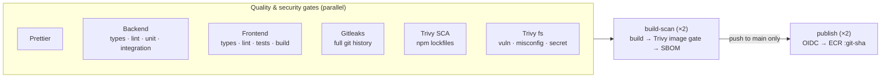

# CI/CD pipeline

Workflow: [`.github/workflows/ci-cd.yml`](../.github/workflows/ci-cd.yml). It runs on pull
requests to `main`, on pushes to `main`, and on manual dispatch. Changes that touch only
`infra/` are skipped here; they go through the separate
[Terraform pipeline](terraform-pipeline.md).

## Stages



| #   | Requirement                  | Where                                                                      |
| --- | ---------------------------- | -------------------------------------------------------------------------- |
| 1   | Checkout                     | every job (`persist-credentials: false`)                                   |
| 2   | Node.js version              | `actions/setup-node` reading `.nvmrc`                                      |
| 3   | Install from lockfiles       | `npm ci --ignore-scripts` per package                                      |
| 4   | Format verification          | `format` job: `prettier --check .`                                         |
| 5   | Lint and tests               | `backend` (with a PostgreSQL service) and `frontend` jobs                  |
| 6   | Secret scanning              | `secrets` job: Gitleaks over the entire git history                        |
| 7   | SCA                          | `sca` job: Trivy on every `package-lock.json`, dev dependencies included   |
| 8   | Filesystem scan              | `fs-scan` job: Trivy vulnerabilities + misconfigurations + secrets         |
| 9   | Build images                 | `build-scan` job, one per tier, exported as a tarball                      |
| 10  | Scan images                  | `build-scan` job: Trivy on that tarball; full JSON report + CycloneDX SBOM |
| 11  | AWS authentication           | `publish` job: GitHub OIDC → `sts:AssumeRoleWithWebIdentity`               |
| 12  | Push with immutable SHA tags | `publish` job: `<registry>/<repo>:<git-sha>`                               |

## What fails the pipeline

- Any formatting, type, lint, test or build error.
- Gitleaks finds anything (default rule set, no exceptions).
- Trivy finds a **HIGH or CRITICAL** vulnerability **that has a fix available**, any
  HIGH/CRITICAL misconfiguration, or a secret, in the repository or in a built image.

Vulnerabilities with no released fix are still shown in the reports and SBOM, but they don't
block, because there is nothing to upgrade to yet. Each run re-checks them, so they block as
soon as a fix ships. MEDIUM and LOW findings are visible in the report artifacts.

`build-scan` depends on every gate, and `publish` depends on `build-scan`, so **no image is
published unless every check passed**.

## Security design

- **No long-lived AWS keys.** The `publish` job requests a GitHub OIDC token
  (`id-token: write`) and exchanges it for 15-minute credentials for one IAM role. That role
  trusts only this repository's `main` branch and may only push to the two ECR repositories.
  It is defined in [`infra/terraform`](../infra/terraform/README.md) and delivered by the
  Terraform pipeline.
- **Credentials only where needed.** The workflow default is `contents: read`. Pull
  requests, including those from forks, never reach the `publish` job, and the jobs that
  build and test code never receive AWS credentials.
- **Scan what you ship.** The image is built once, exported to a tarball, scanned, then that
  same tarball is loaded and pushed, so there is no rebuild between scanning and publishing.
- **Immutable, traceable tags.** Images are tagged with the full commit SHA and labelled
  `org.opencontainers.image.revision`. A re-run for an already-published SHA is a no-op.
- **Pinned supply chain.** Third-party actions are pinned to full commit SHAs, and the
  Gitleaks/Trivy images and Docker base images to digests. Dependabot
  ([`.github/dependabot.yml`](../.github/dependabot.yml)) proposes updates as PRs, and those
  run through the same gates.
- **No install scripts.** `npm ci --ignore-scripts` stops dependency lifecycle scripts
  from running in CI or in image builds.

## Configuration

Set these as GitHub **repository variables** (Settings → Secrets and variables → Actions →
Variables). They are identifiers, not secrets, and **no GitHub secrets are needed**.

| Variable                  | Example                                                  | Required |
| ------------------------- | -------------------------------------------------------- | -------- |
| `AWS_ROLE_ARN`            | `arn:aws:iam::123456789012:role/github-actions-ecr-push` | yes      |
| `AWS_REGION`              | `eu-west-1`                                              | yes      |
| `ECR_REPOSITORY_BACKEND`  | `task-platform/backend` (default)                        | no       |
| `ECR_REPOSITORY_FRONTEND` | `task-platform/frontend` (default)                       | no       |

Until `AWS_ROLE_ARN` is set, pushes to `main` still run every gate and build and scan the
images. The `publish` job is skipped and a warning is added to the run.

## Running the checks locally

```bash
npm ci && npm run format:check
(cd backend && npm ci && npm run typecheck && npm run lint && npm test)
(cd frontend && npm ci && npm run typecheck && npm run lint && npm test && npm run build)
docker run --rm -v "$PWD:/repo" ghcr.io/gitleaks/gitleaks:v8.30.1 git /repo --config /repo/.gitleaks.toml --redact
trivy fs --scanners vuln,misconfig,secret --severity HIGH,CRITICAL --ignore-unfixed --skip-dirs node_modules .
```

Backend integration tests need a disposable database; see `backend/README.md`.
