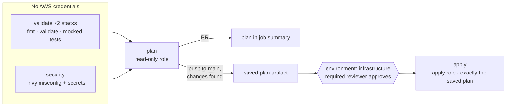

# Terraform pipeline

Workflow: [`.github/workflows/terraform.yml`](../.github/workflows/terraform.yml). It runs
when anything under `infra/` (or the workflow itself) changes, on pull requests and pushes to
`main`, and on manual dispatch. The application pipeline (`ci-cd.yml`) ignores
infrastructure-only changes, so they never rebuild or republish images.

## Stages

| Job        | Runs on                    | AWS access                     | Does                                                                                                                   |
| ---------- | -------------------------- | ------------------------------ | ---------------------------------------------------------------------------------------------------------------------- |
| `validate` | PRs, main                  | none                           | `fmt -check`, `init -backend=false -lockfile=readonly`, `validate`, `test` for `infra/bootstrap` and `infra/terraform` |
| `security` | PRs, main                  | none                           | Trivy misconfiguration + secret scan of `infra/`; fails on HIGH/CRITICAL                                               |
| `plan`     | PRs from this repo, main   | **plan role** (read-only)      | `plan -detailed-exitcode -out=tfplan`; plan rendered into the job summary; on `main` the plan is uploaded              |
| `apply`    | main, only if plan changed | **apply role**, after approval | downloads the saved plan and runs `terraform apply tfplan`                                                             |

## Controls and why

- **Plan/apply separation with human approval.** Only jobs in the `infrastructure` GitHub
  environment can assume the apply role, because AWS checks the token's
  `environment:infrastructure` subject. The environment's required reviewers and "main only"
  branch rule are the approval gate.
- **What was reviewed is what gets applied.** `apply` never re-plans. It applies the
  artifact the reviewer saw, and Terraform rejects that plan if state changed since it was
  made.
- **Read-only plans.** The plan role cannot write anything, not even the state lock, so
  plans run with `-lock=false`. That's safe because applying a stale plan fails. A pull
  request that edits the workflow could run arbitrary commands with this role, but they
  could only read the ECR stack's state and configuration.
- **No privilege escalation.** The apply role may only create or grant permissions to roles
  that carry the bootstrap's permissions boundary (ECR push only). It cannot touch its own
  roles, the boundary, other projects' resources, or the bootstrap state. See
  [infra/bootstrap/README.md](../infra/bootstrap/README.md#why-the-apply-role-cannot-escalate-privileges).
- **The pipeline never manages its own permissions.** `infra/bootstrap` is tested in CI but
  applied only by an administrator.
- **Serialized applies.** `concurrency: terraform-apply` with no cancellation, plus S3-native
  state locking.
- **Reproducible toolchain.** Terraform 1.15.7, the provider lock file used read-only, and
  actions pinned to commit SHAs. Dependabot proposes provider and action updates.
- **Fork PRs** receive no OIDC token from GitHub, so they get validate/security but no plan.

## Configuration

Repository variables (all non-secret), produced by `infra/bootstrap` outputs:

| Variable                      | Used by                                           |
| ----------------------------- | ------------------------------------------------- |
| `AWS_REGION`                  | plan, apply                                       |
| `TF_STATE_BUCKET`             | plan, apply                                       |
| `TF_PLAN_ROLE_ARN`            | plan                                              |
| `TF_APPLY_ROLE_ARN`           | apply                                             |
| `TF_PERMISSIONS_BOUNDARY_ARN` | plan, apply                                       |
| `TF_STATE_KEY` (optional)     | defaults to `task-platform/ecr/terraform.tfstate` |

Until `TF_PLAN_ROLE_ARN` is set, the workflow runs `validate` and `security` and skips
plan/apply with a warning.

## Operating it

- **Approving:** open the run, read the plan in the `plan` job summary, then _Review
  deployments → Approve_ on the `apply` job.
- **Rejecting:** reject the deployment. Nothing is applied, and the saved plan expires
  after 5 days.
- **Stale plan:** if apply fails with "Saved plan is stale", re-run the workflow to plan and
  review again.
- **Rolling back:** revert the commit in a PR. The pipeline plans and applies the revert like
  any other change. Previous state versions remain in the versioned bucket for inspection.
